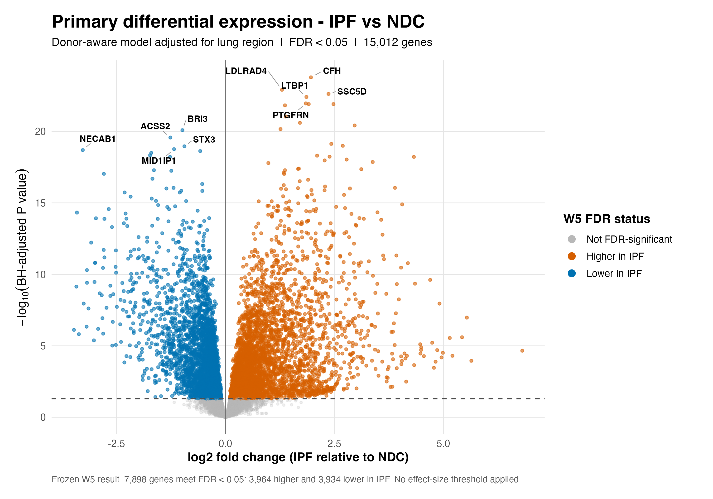
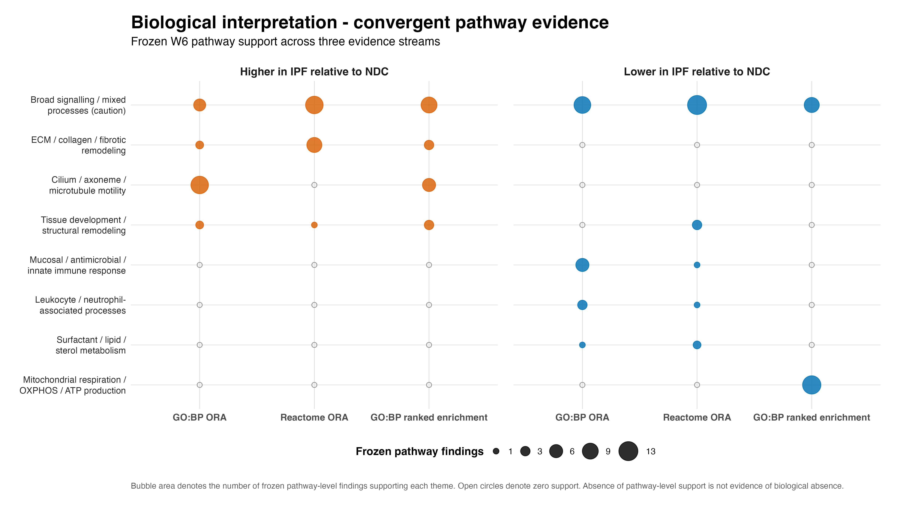
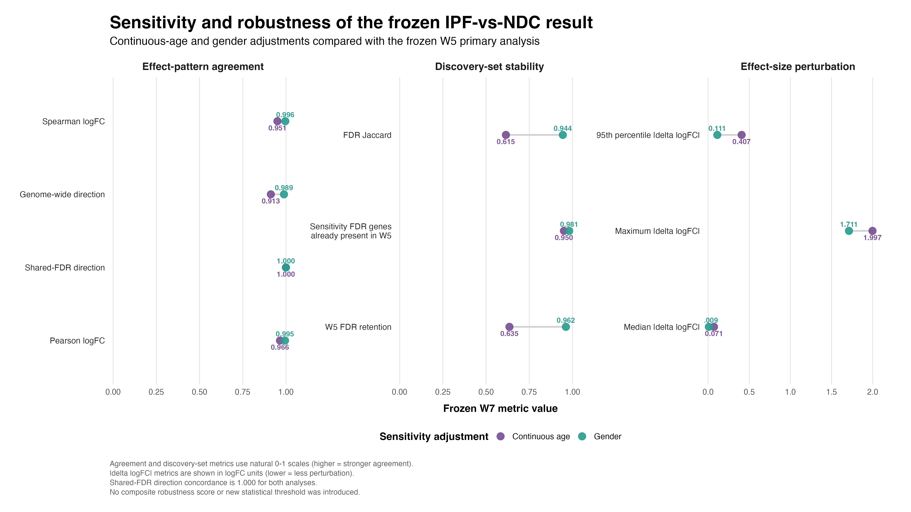

# Reproducible RNA-seq analysis of idiopathic pulmonary fibrosis

**GSE213001 | IPF vs non-diseased control (NDC) | R / Bioconductor**

This repository contains a reproducible RNA-seq workflow investigating
transcriptomic differences between idiopathic pulmonary fibrosis (IPF) and
non-diseased control (NDC) lung tissue using the public GEO dataset
**GSE213001**.

The project was developed as an end-to-end bioinformatics portfolio study
with emphasis on statistical design, donor-aware inference, biological
interpretation, sensitivity analysis, reproducibility, quality control, and
transparent reporting.

The principal inferential result is the frozen donor-aware differential-
expression analysis adjusted for lung region and within-donor correlation.
Subsequent analyses evaluate biological interpretation and robustness without
replacing or redefining that primary result.

---

## Project objective

The central question is:

> Which transcriptomic differences distinguish IPF from non-diseased lung
> tissue, and how robust are those differences to biologically relevant
> analytical adjustments?

The workflow separates three complementary questions:

1. **Differential expression** — which genes differ between IPF and NDC?
2. **Biological interpretation** — which pathway-level themes are supported
   by the frozen differential-expression result?
3. **Sensitivity and robustness** — how stable is the primary result after
   continuous-age and gender adjustment?

---

## Analytical design

The primary IPF-vs-NDC model:

- uses the public **GSE213001** RNA-seq dataset;
- accounts for **lung region**;
- accounts for **within-donor correlation**;
- uses Benjamini-Hochberg **FDR < 0.05** for statistical significance;
- does **not** introduce an additional effect-size significance threshold.

The primary differential-expression analysis was frozen before the
interpretation and sensitivity stages. Later stages therefore assess the
existing result rather than redefine it.

---

## Key frozen differential-expression result

| Metric | Frozen W5 result |
|---|---:|
| Genes tested | 15,012 |
| FDR-significant genes | 7,898 |
| Higher in IPF | 3,964 |
| Lower in IPF | 3,934 |
| Statistical threshold | BH FDR < 0.05 |
| Additional effect-size threshold | None |

These values represent the frozen primary donor-aware IPF-vs-NDC analysis.

---

## 1. Primary differential expression



The final portfolio volcano plot summarizes the complete frozen W5
differential-expression result.

The visualization preserves the original inferential boundary:

- orange: genes significantly higher in IPF;
- blue: genes significantly lower in IPF;
- grey: genes not significant at FDR < 0.05.

Selected labels identify the lowest-FDR mapped genes in each direction for
visual orientation only. Gene ranking and statistical inference were not
modified during W8 reporting.

---
## 2. Biological interpretation



Biological interpretation was performed from the frozen differential-
expression result using three complementary pathway evidence streams:

- GO Biological Process over-representation analysis;
- Reactome over-representation analysis;
- GO Biological Process ranked enrichment.

The final matrix summarizes pathway-level support across the frozen evidence
streams rather than treating any single enrichment result as definitive.

Controlled biological themes include:

- extracellular matrix, collagen, and fibrotic remodelling;
- structural and tissue-remodelling processes;
- cilium, axoneme, and microtubule-associated biology;
- mucosal, antimicrobial, and innate immune processes;
- leukocyte and neutrophil-associated processes;
- surfactant, lipid, and sterol metabolism;
- mitochondrial respiration, oxidative phosphorylation, and ATP production;
- broad signalling and mixed processes requiring pathway-specific caution.

Directionality is interpreted relative to IPF versus NDC.

Absence of pathway-level support is **not** interpreted as evidence of
biological absence.

---

## 3. Sensitivity and robustness



The frozen W5 result was compared with two prespecified W7 sensitivity
analyses:

1. continuous-age adjustment;
2. gender adjustment.

The purpose of these analyses was to evaluate stability of the frozen primary
result rather than to replace it.

| Robustness metric | Continuous age | Gender |
|---|---:|---:|
| Pearson correlation of genome-wide logFC | 0.966 | 0.995 |
| Spearman correlation of genome-wide logFC | 0.951 | 0.996 |
| Genome-wide direction concordance | 0.913 | 0.989 |
| W5 FDR-significant genes retained | 0.635 | 0.962 |
| Shared-FDR direction concordance | 1.000 | 1.000 |
| FDR-set Jaccard similarity | 0.615 | 0.944 |
| Median absolute logFC perturbation | 0.071 | 0.009 |
| 95th percentile absolute logFC perturbation | 0.407 | 0.111 |
| Maximum absolute logFC perturbation | 1.997 | 1.711 |

The sensitivity analyses show strong stability of the genome-wide effect
pattern, particularly after gender adjustment.

Continuous-age adjustment produces a larger change in the FDR-significant
discovery set than gender adjustment while retaining high agreement in
genome-wide effect direction.

Among genes significant in both the primary and sensitivity analyses,
direction concordance is 1.000 for both sensitivity models.

These analyses assess robustness of the primary result. They do **not**
establish that age or gender has no biological or statistical influence.

No composite robustness score or additional statistical threshold was
introduced.

---

## Final report

The complete analytical narrative, quality-control summary, biological
interpretation, robustness assessment, limitations, and reproducibility
information are available in the final report:

- [Final report - HTML](reports/final_report.html)
- [Final report - PDF](reports/final_report.pdf)
- [Quarto report source](reports/analysis.qmd)

The README is intended as a concise portfolio landing page. The final report
is the authoritative narrative synthesis.

---
## Reproducibility

The repository preserves the analytical workflow, intermediate quality-control
records, frozen result tables, final figures, and final report used to support
the conclusions presented here.

Key reproducibility components include:

- R-based analytical scripts;
- Bioconductor-based RNA-seq analysis;
- `renv` environment infrastructure;
- a project-level `_targets.R` workflow definition;
- Quarto-based final reporting;
- frozen analytical checkpoints;
- explicit QC metadata and provenance records.

The final W8 reporting layer does not refit the frozen W5 differential-
expression model or rerun the frozen W6/W7 inferential analyses.

The final portfolio figures are presentation-oriented summaries generated from
previously frozen analytical outputs.

### Requirements

The reproducible R environment recorded by the project uses **R 4.5.1**.

A fresh environment requires:

- R compatible with the version recorded in `renv.lock`;
- Git;
- internet access for restoring R packages and obtaining the public GEO inputs;
- Quarto only if the report source is to be rendered again.

### Quick start

Clone the repository and enter the project directory.

Restore the recorded R package environment:

```r
renv::restore()
```

The tracked source-data directory intentionally does not contain the public
source files themselves. Before running the target graph, obtain the two
GSE213001 source files documented in `data/README.md` and place them under
`data/source/` with the expected filenames.

The project-level target graph can then be executed with:

```r
targets::tar_make()
```

The current `_targets.R` definition reconstructs the reproducible W1-W4
foundation of the project: source-data validation, import and metadata
alignment, quality control, filtering, normalization, and ordination QC.

The later W5-W8 analytical and reporting stages are preserved as versioned
scripts, frozen result tables, QC records, figures, and final reports. They are
not presented as a one-command automatic rebuild through the current
`_targets.R` graph.

This distinction is intentional: the repository preserves both executable
pipeline infrastructure and the frozen analytical checkpoints used for the
final portfolio interpretation.

---

## Repository structure

The principal repository directories are:

| Directory | Purpose |
|---|---|
| `R/` | Analytical and reporting scripts |
| `data/` | Public-source data landing area and data-acquisition documentation |
| `metadata/` | QC, provenance, mapping, and audit records |
| `results/` | Differential-expression, enrichment, interpretation, and sensitivity results |
| `figures/` | Analytical and final portfolio figures |
| `reports/` | Quarto report source and rendered final reports |
| `docs/` | Analytical decisions and project documentation |

Important final deliverables include:

- `figures/final/W8_primary_IPF_vs_NDC_volcano.png`
- `figures/final/W8_biological_interpretation_matrix.png`
- `figures/final/W8_robustness_summary.png`
- `reports/final_report.html`
- `reports/final_report.pdf`

---

## Quality-control and provenance strategy

The project uses staged QC and freeze points to separate analytical decisions
from later interpretation and presentation.

In particular:

- the primary W5 differential-expression result was frozen before biological
  interpretation;
- the W6 biological interpretation was frozen before sensitivity analysis;
- the W7 sensitivity and robustness analyses were frozen before W8 reporting;
- W8 consumed frozen outputs without redefining inferential results.

This structure provides an explicit audit trail between analytical generation,
interpretation, robustness assessment, and final presentation.

---

## Limitations

This analysis should be interpreted within the constraints of the available
dataset and study design.

Important limitations include:

- the analysis is based on a single public GEO dataset;
- observational transcriptomic associations do not establish causality;
- pathway enrichment depends on gene-set definitions and annotation coverage;
- absence of enrichment support is not evidence that a biological process is
  absent;
- sensitivity analyses assess robustness to prespecified covariate adjustments
  but cannot exclude all possible confounding;
- RNA-seq measurements represent bulk tissue and therefore reflect both
  transcriptional regulation and cellular-composition differences;
- external validation in independent IPF cohorts would strengthen the
  generalizability of the findings.

The biological interpretation is therefore intended as a controlled synthesis
of the available evidence rather than a definitive mechanistic model.

---

## Final project status

The portfolio analysis is analytically complete through W8.

The frozen result hierarchy is:

1. **W5** — primary donor-aware IPF-vs-NDC differential expression;
2. **W6** — controlled biological interpretation;
3. **W7** — continuous-age and gender sensitivity analyses with combined
   robustness interpretation;
4. **W8** — final visualization, reporting, QC, and repository presentation.

The W8 layer changes presentation and navigation only. It does not alter the
scientific meaning of the frozen W5-W7 analyses.

For the complete scientific narrative, consult the
[final report](reports/final_report.html).

---

## Technology

Core tools used in the project include:

- R;
- Bioconductor;
- limma / voom-based differential-expression methodology;
- ggplot2;
- Quarto;
- renv;
- targets;
- Git and GitHub.

---

## Author

**Joan Carreras Díaz**

Biomedical Engineer
MSc Bioinformatics & Biostatistics

Portfolio project focused on reproducible biomedical data science,
bioinformatics, biostatistics, and translational life-science analytics.
